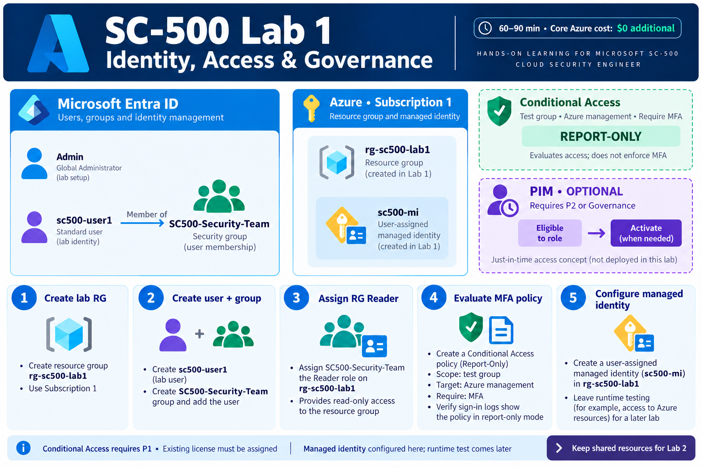
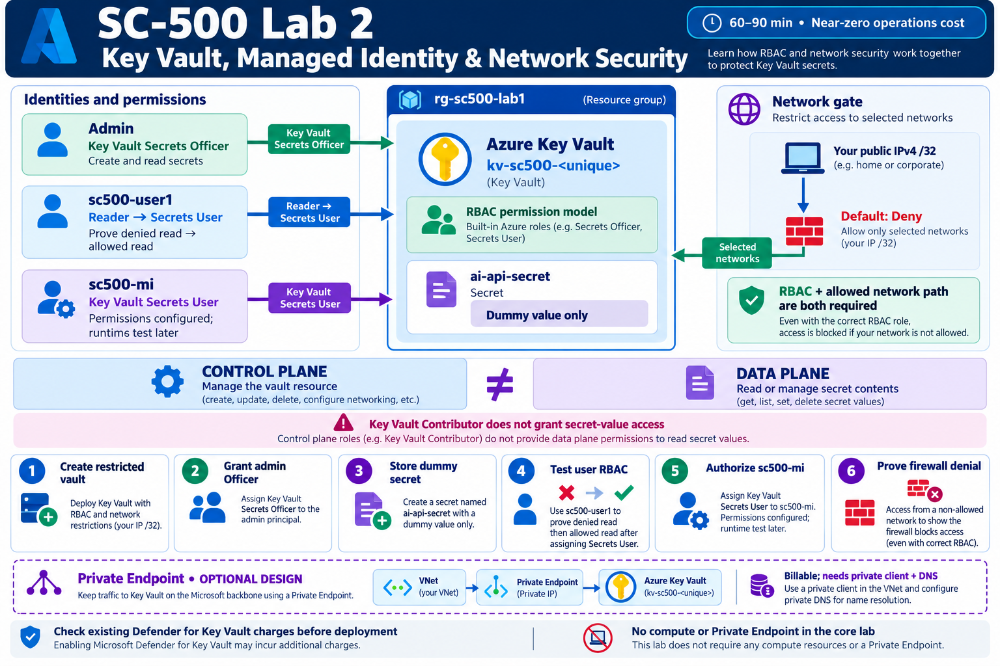

# SC-500 hands-on labs

Practical Azure and Microsoft Entra security labs, with validation steps, cleanup instructions and YouTube recording outlines. The series targets **less than USD 4 additional Azure spending in total**, excluding existing Microsoft 365 licensing. These are prepared guides; live deployment and validation are still pending.

Start with the [tenant review and five-lab plan](Tenant-review-and-series-plan.md). The review is a point-in-time snapshot, so recheck licensing, effective policies and pricing before deployment.

## Lab 1 — Identity, access and governance

**[Open Lab 1 guide →](Lab-01-Identity-Access-Governance.md)**

Create the test user and security group, assign Reader at the resource-group scope, evaluate an MFA Conditional Access policy in report-only mode, and configure a managed identity. Target duration: **60–90 minutes**, plus optional PIM.

- Core Azure identity/RBAC steps target **$0 additional Azure cost**. Conditional Access needs an assigned P1 entitlement; the reviewed tenant has available Business Premium seats.
- PIM requires suitable P2 or Governance licensing and remains optional. Report-only Conditional Access evaluates policy without enforcing MFA.
- Keep `rg-sc500-lab1`, `sc500-mi`, `SC500-Security-Team` and `sc500-user1` for Lab 2. Follow the handoff checkpoint before performing cleanup.

## Lab 2 — Key Vault, managed identity, RBAC and network security

**[Open Lab 2 guide →](Lab-02-Key-Vault-Managed-Identity.md)**

Create an isolated RBAC vault, store a dummy secret, prove the difference between resource access and secret access, authorize the managed identity, and test IP firewall denial. Target duration: **60–90 minutes**.

- Tiny Key Vault operations target near-zero cost; **check existing Defender for Key Vault coverage and charges before creating a vault**.
- The core lab proves live access as users. Managed identity runtime retrieval requires a supported Azure workload and is deferred.
- Private Endpoint is a **billable optional design section**. No compute or Private Endpoint is deployed by the core guide.
- Recovery protection means a deleted lab vault cannot be immediately purged. Use the guide's cleanup procedure.

## Upcoming labs

| Lab | Planned focus | Status |
|---|---|---|
| 3 | Network governance, NSGs, Azure Policy and locks | Planned |
| 4 | Compute and AI security posture | Planned |
| 5 | Monitoring, Activity Log, Defender and existing Sentinel data | Planned |

This budget-focused series covers selected [SC-500 objectives](https://learn.microsoft.com/en-us/credentials/certifications/resources/study-guides/sc-500); it is not complete hands-on coverage of every exam technology. Cost alerts do not impose a hard spending cap.

The overview illustrations were created with the built-in image generation tool. [Generation prompts](assets/image-prompts.md) are included for future revisions. Follow the written guides for exact commands, permission scopes and validation steps.
